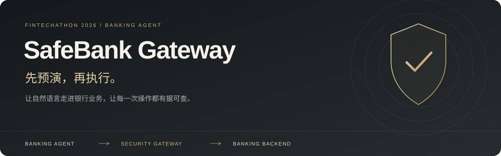
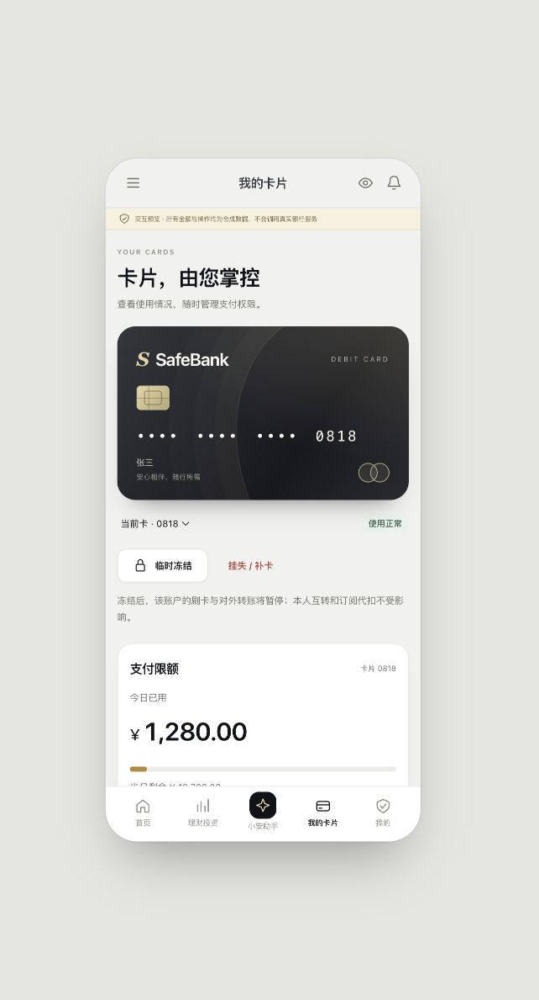
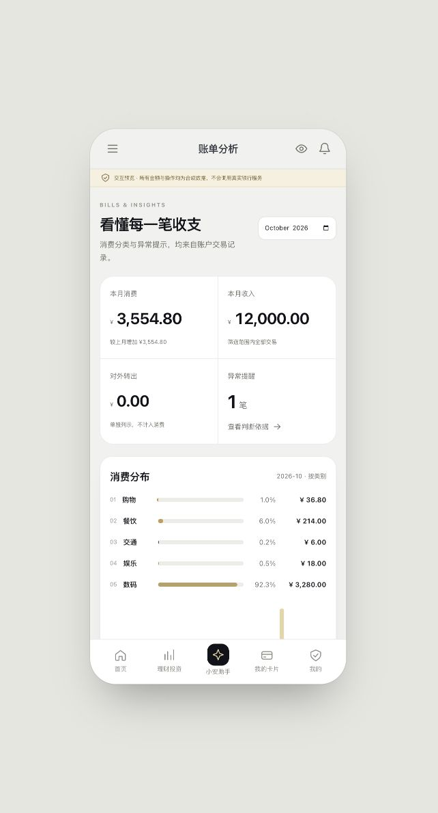
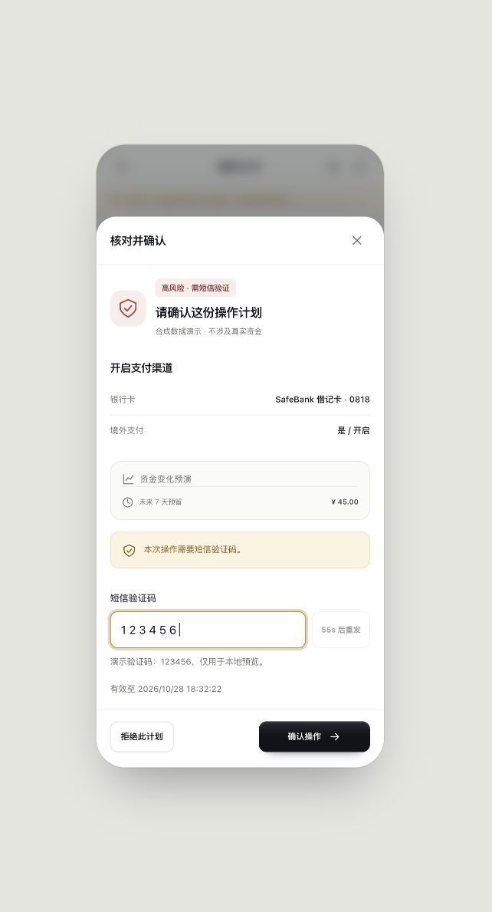
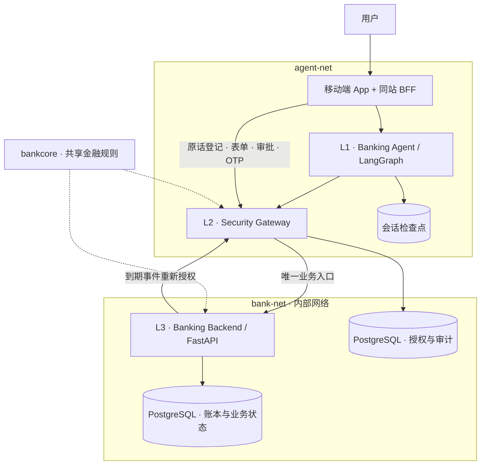

<p align="center">
  
</p>

<p align="center">
  <strong>银行 AI 助手与金融业务安全网关</strong><br>
  2026 深圳国际金融科技大赛 · 人工智能赛道「银行 AI 智能体」
</p>

<p align="center">
  <a href="#六类业务一个助手">业务场景</a> ·
  <a href="#为什么需要安全网关">核心设计</a> ·
  <a href="#技术指标与验证">技术指标</a> ·
  <a href="#启动与部署">启动部署</a> ·
  <a href="docs/README.md">技术文档</a>
</p>

SafeBank 把账户、账单、银行卡、订阅和理财放进一个移动端银行 App。用户可以直接操作，也可以交给助手「小安」：查清情况、补全参数、安排多个步骤，最后在独立的确认面板中授权。

银行助手需要理解用户，更需要守住资金与权限边界。SafeBank 在模型和银行后端之间设置独立的 **Security Gateway**。一份操作计划必须经过参数来源核验、金融状态预演和工作流风险检查，才能进入执行环节。模型负责提出计划，确定性规则负责授权。

## 六类业务，一个助手

| 场景 | 支持的业务 | 安全检查重点 |
|---|---|---|
| 智能转账 | 本人互转、向收款人转账、定时转账、AA 收款、收款人管理 | 收款人与金额授权范围、卡限额、累计转出、未来资金缺口 |
| 账单分析 | 流水查询、分类统计、月度对比、余额趋势、异常交易识别 | 交易备注作为不可信数据，分析内容不能直接变成操作授权 |
| 卡片管理 | 限额、支付渠道、冻结与解冻、挂失与补卡 | 卡片归属、状态约束、放宽权限与高风险操作确认 |
| 订阅管理 | 识别周期扣款、查看闲置订阅、取消代扣、追踪后续扣费 | 闲置条件由规则核实，取消后到期扣费仍有拦截记录 |
| 理财操作 | 产品查询与比较、风险测评、持仓、申购与赎回 | 风险适当性、份额精度、资金冻结、确认与结算生命周期 |
| 跨场景联动 | 取消闲置订阅后定期转存、结合未来账单安排资金 | 整份计划累积预演，派生金额可重算，跨步骤与跨会话风险检查 |

六类业务的界面、契约与领域实现均已纳入仓库；真实链路验收范围见下方指标与[验证说明](docs/validation.md)。

<table>
  <tr>
    <td align="center"><br>银行卡管理</td>
    <td align="center"><br>账单分析</td>
    <td align="center"><br>独立审批面板</td>
  </tr>
</table>

*截图来自合成数据预览，展示交互与视觉设计；真实执行结果以 L3 数据库验收记录为准。*

## 为什么需要安全网关

一次「先提高限额，再新增收款人，最后转账」的请求，逐步检查可能都能通过，组合起来却可能改变用户原本的风险边界。商户名称、交易备注和模型生成内容也可能夹带额外指令。SafeBank 把这些问题放到执行边界统一处理。

### 1. 用同一套金融规则预演与执行

L2 在内存中的影子状态上依次预演整份计划，检查余额、卡片状态、限额、理财适当性与未来七天的资金安排。预演不写银行数据库，与 L3 执行共用 [`bankcore`](packages/bankcore/) 纯函数规则，减少两套逻辑之间的偏差。

### 2. 跟踪参数从哪里来

用户原话由网关独立登记。计划中的金额、目标和关键参数需要给出来源；派生金额只能使用可重算的模板。工具返回的自由文本标记为不可信，表单也接受来源与污点检查。模型无法通过自报 `origin` 获得表单权限。

### 3. 看整段业务过程

网关结合当前计划和已落库的历史操作检查拆分转账、累计转出与危险操作组合。定时转账和商户代扣到期时再次回到网关授权，创建时的确认不能替代执行时的状态检查。

### 4. 把确认绑定到具体内容

确认面板由网关提供，审批绑定计划内容与 `view_hash`。绿色按策略执行，黄色要求确认，红色增加 OTP。审批后余额、风险或计划内容变化，会触发复演与必要的重新确认；模型持有的助手令牌不能替用户完成审批。

### 5. 处理「请求超时，但钱可能已转出」

银行后端提供 `prepare → execute → reconcile` 协议，使用客户与计划标识保证幂等。结果未知时保留 `UNKNOWN`，通过持久化执行记录对账恢复，避免换一个请求重做业务。账本、业务状态、执行结果和 outbox 在同一事务中提交，网关另存可校验的审计哈希链。

## 三层架构



L1 不在银行网络中，也不持有 L3 业务调用凭证。浏览器只访问同站 BFF；浏览器令牌、助手令牌、服务令牌分开使用。网络、凭证和授权矩阵共同约束调用路径。详见[架构与执行流程](docs/architecture.md)。

| 层次 | 技术与职责 |
|---|---|
| App / BFF | React 18、TypeScript、Vite、Node.js 22；移动端界面、同站会话、审批与流式消息适配 |
| L1 | Python 3.12、LangGraph、DeepSeek V4 Pro；意图理解、只读收集、结构化计划、暂停与恢复 |
| L2 | FastAPI、Pydantic v2、YAML 策略；来源检查、预演、工作流规则、审批、OTP、审计 |
| L3 | FastAPI、PostgreSQL 16、SQLAlchemy、Alembic；账本、业务执行、事件调度与恢复 |
| 共享层 | Pydantic 契约与纯函数内核；金额使用整数分，份额使用四位 Decimal |
| 部署与验证 | Docker Compose 双网络、uv / npm 锁文件、pytest、Vitest、Node Test Runner |

## 技术指标与验证

以下自动化结果于 **2026-11-02** 在代码基线 `f324c52` 上重跑。测试通过数用于说明工程验证范围，业务效果另列数据库证据。

| 项目 | 结果 | 口径 / 复现入口 |
|---|---|---|
| 后端与共享组件回归 | **4,977 项通过** | `make test`；另有 1,169 项条件跳过，专门的 PostgreSQL / 权限测试须显式启用 |
| 前端回归 | **494 项通过** | `cd frontend && npm test`；50 个测试文件 |
| BFF 边界回归 | **16 项通过** | `cd frontend && npm run test:bff`；使用本地测试上游 |
| 前端构建 | **通过** | `cd frontend && npm run build`；TypeScript 检查与 Vite 构建 |
| 业务工具契约 | **18 读 / 14 写** | [契约快照](docs/contracts/v1.json)；`make contracts-check` |
| L1 稳定性语料 | **405 条 / 11 类** | [语料目录](evaluation/corpus/l1_stability/)；含正常、歧义、越界与 A1–A3 攻击输入 |

已有真实服务与数据库验收包括：

| 实测场景 | 数据库结果 | 证据 |
|---|---|---|
| 定时转账 | 每期 200 元，连续两期共 400 元；无重复到期执行 | [记录](docs/acceptance/schedule-provenance-live.json) |
| 取消闲置订阅并转存 | 仅取消目标订阅；每期转存 199 元，两期共 398 元；原订阅两期扣款均被拦截 | [记录](docs/acceptance/idle-subscription-savings-live.json) |
| 红级挂失 | OTP 确认后卡片变为 `LOST`；一次业务操作，无转账 | [记录](docs/acceptance/lost-card-source-live.json) |
| 申购结算与模拟时钟 | 2,000 元申购已结算；16 个到期事件形成 14 个成功、2 个拦截终态，账本平衡 | [记录](docs/acceptance/demo-clock-live.json) |
| 基金赎回 | 货币基金真实 L1 赎回 1,000 份并入账 1,000 元；非货币基金表单赎回 100 份，结算入账 123.11 元 | [记录](docs/acceptance/redemption-sources-live.json) |
| 表单授权与幂等 | 200 元转账与冻结完成；重复请求未增加业务写入；未伪造用户原话 | [记录](docs/acceptance/form-authorization-live.json) |

这些记录对应各自标注的提交与独立合成数据集。当前尚未发布完整六场景两轮验收、全量攻击成功率（ASR）、任务完成率（TSR）及性能基准。评测方法与证据索引见[验证说明](docs/validation.md)。

## 启动与部署

### 仅体验界面

需要 Node.js 22。无需模型密钥和 Docker。

```bash
git clone https://github.com/SJeffZhang/Safebank.git
cd Safebank/frontend
npm ci
npm run dev -- --host 127.0.0.1
```

打开 [http://127.0.0.1:5173](http://127.0.0.1:5173)。默认使用合成预览，刷新后恢复初始状态；预览 PIN 与验证码均为 `123456`，小安使用说明性回复。

### 启动完整演示栈

需要 Python 3.12、uv、Docker Engine 与 Compose v2；首次构建需要网络。模型请求使用自备 DeepSeek API，产生实际调用费用。

在仓库根目录操作：

```bash
cp .env.example .env
# 在 .env 中填写 DEEPSEEK_API_KEY
make setup
make keys
export COMPOSE_FILE=docker-compose.yml:docker-compose.demo.yml
make up
make seed-demo
```

打开 [http://127.0.0.1:3000](http://127.0.0.1:3000)。登录 PIN 由 `make keys` 随机生成并保存在本机 `.secrets/demo_pins`，与预览 PIN 不同。首次部署的到期业务授权初始化、OTP 控制台、HTTPS 配置和排错步骤见[部署指南](docs/deployment.md)。

演示配置只向 Agent 注入模型密钥，并开启合成数据演示接口；继续使用完整 B2 安全策略和原有双网络隔离。所有业务数据均为合成数据，无真实银行连接或资金清算。

## 代码与文档入口

```text
frontend/               移动端银行 App 与同站 BFF
services/agent/         L1：理解、规划、检查点与恢复
services/gateway/       L2：安全策略、授权、审批与审计
services/bank-backend/  L3：账本、银行业务与模拟时钟
packages/contracts/    跨层工具、计划与执行协议
packages/bankcore/     预演与执行共享的金融规则
evaluation/            语料、评测驱动与指标计算
tests/                 单元、真实 PostgreSQL、并发与一致性测试
docs/                  部署、架构、验收证据与设计决策
```

[文档导航](docs/README.md) · [产品与接口规格](PRD.md) · [部署指南](docs/deployment.md) · [验证与指标口径](docs/validation.md) · [安全边界](SECURITY.md) · [第三方依赖](docs/third-party.md)

SafeBank 是竞赛研究原型。适当性校验与产品比较用于模拟业务，不能替代投资建议；黄级确认依赖浏览器完整性，演示 OTP 不代表真实带外短信。当前 BFF 会话保存在内存中，多实例与生产高可用未验收。
